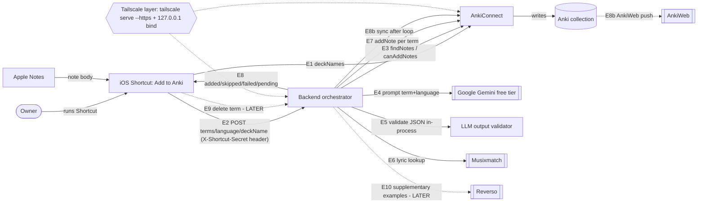
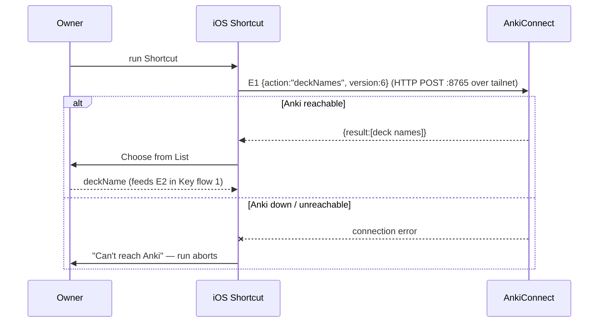

# Notes-to-Anki Vocabulary Shortcut — Design Document

**Status:** Draft (v2 — post-review) | **Last updated:** 2026-09-08 | **Author(s):** owner (veeshah.14@gmail.com)
**Source input:** interview capture at `/Users/vee/Language-Agent/.design-brief.md` (the placeholder `DesignDocument.txt` was empty)

## 1. Overview

### 1.1 Problem

The owner captures vocabulary in the iPhone Notes app in the moment but rarely turns it
into Anki cards, because building cards by hand is a chore. Almost none of the captured
words reach Anki. They want a one-tap path from a list of words in a note to finished,
richly auto-populated Anki cards in a deck they choose, with no computer involved.

The system is an iPhone Apple Shortcut that sends the note's terms to an always-on Python
backend. The backend generates rich **monolingual** Anki cards (definitions and examples
in the target language only) using the Google Gemini free tier, optionally enriches each
card with a song-lyric line, and adds the cards to a user-chosen deck via AnkiConnect.

### 1.2 Goals

- Move from ~0% of captured words reaching Anki to ~100%.
- One tap (share sheet from a note) to finished cards; no computer in the loop.
- Run at **$0/month**: free hosting plus the Gemini free-tier API.
- Every card is monolingual in the target language — no translation anywhere on the card.
- Re-running the Shortcut on the same note is always safe (no duplicate cards).

### 1.3 Non-goals

- **Translation on cards** — permanently out. Definitions and examples are monolingual,
  enforced by both the generation prompt and a post-generation validator.
- **General famous-quotations feature** — the "quote" idea is satisfied by a song-lyric line only.
- **AnkiMobile (paid) / AnkiDroid (Android)** — out; the owner uses free Anki + AnkiWeb sync.
- **Images / audio / cloze / rich card types** in v1 **[ASSUMPTION A2 — veto later ok]**.
- **Delete-from-deck** — a real requirement but out of v1 (see §11, M5).
- **Multi-user / a hosted service for anyone else** — permanently out. Single user.

### 1.4 Constraints

- iPhone + Apple Shortcuts is the only client.
- Must run at **$0**: free hosting and the **Google Gemini free tier** via its
  OpenAI-compatible endpoint (`https://generativelanguage.googleapis.com/v1beta/openai/`),
  no paid API key. Provider stays swappable via `LLM_BASE_URL` / `LLM_MODEL` / `LLM_API_KEY`.
- No hard deadline.
- Target languages in scope: **French, Spanish, Norwegian**. Pipeline is language-agnostic
  (language is a passthrough parameter). Known gap: thin Norwegian song coverage in Musixmatch.
- Deliverable is a set of business + technical requirements (this document).

### 1.5 Prior art / reference implementation — otjServices

The sibling **otjServices** repo has the same shape: mobile app → one always-on box →
drives a third-party platform, with an LLM step. This project reuses:

- **Deployment substrate:** one small VM, rootless **Podman + systemd Quadlet** units,
  env-file config, a `/health` endpoint, a redeploy script. (otjServices also runs Caddy +
  Cloudflare for its *public* API; this project has no public surface, so both are skipped.)
- **Private-surface auth:** service bound to `127.0.0.1`, reachable only via
  `tailscale serve --https`; no firewall port. Adopted directly here.
- **LLM approach:** otjServices `use-free-ai` branch uses a free OpenAI-compatible provider
  via `LLM_BASE_URL` / `LLM_MODEL` / `LLM_API_KEY`; its `llm_prompt.txt` + structured-output
  + validation pattern is the template for FR4/FR5.

Not reusable: the Java 25 / Jersey / Dagger code — this project is Python (Musixmatch package).

## 2. Users & scenarios

### 2.1 User types

| User type | Description | Primary needs |
|-----------|-------------|---------------|
| Owner (mobile) | The owner, on iPhone, running the Shortcut from a note | One tap from a word list to finished cards in a chosen deck; a clear per-run summary |
| Backend host operator | The owner, operating the always-on host | Cheap ($0) always-on hosting; safe re-runs; a per-run log to diagnose problems |

### 2.2 Scenarios

1. **Scenario A — Add batch (the common case).**
   Trigger: owner has 1–10 terms, one per line, in a note and runs the "Add to Anki"
   Shortcut (share sheet, or run + pick the note).
   Steps: Shortcut splits the note into entries and rejects the run if there are more than
   10 (FR1) → prompts for **target language** (default pre-filled) and **target deck** (list
   fetched live from AnkiConnect → Choose from List) → Shortcut POSTs
   `{terms[], language, deckName}` to the backend with the shared secret in an
   `X-Shortcut-Secret` header (never in the body) → backend, per new term: dedup-check
   against Anki → call the LLM → validate → optionally fetch a lyric → assemble a note →
   add via AnkiConnect → after the loop, trigger an AnkiWeb `sync` → backend returns
   `{added[], skipped[], failed[], pending[]}` (`pending` = entries not reached before the
   8-min run cap).
   Outcome: Shortcut shows `added: N / skipped (dup): M / failed: K (terms) / pending: P (terms)`;
   the owner re-runs to clear `failed` + `pending` (dedup makes re-runs safe).

2. **Scenario B — Deck pick.**
   Trigger: any run (used inside Scenario A).
   Steps: Shortcut calls AnkiConnect `deckNames` → Choose from List.
   Outcome: the chosen `deckName` feeds Scenario A. This is the mechanism that lets the
   owner "specify the deck".

3. **Scenario C — Delete a word (LATER, not v1).**
   Trigger: a separate Shortcut; owner supplies a term (+ deck).
   Steps: backend `findNotes` then `deleteNotes`.
   Outcome: the card is removed. Confirmation UX and multi-deck matches are **[OPEN O4]**.

## 3. Requirements

### 3.1 Functional

| # | Requirement | Priority | Trigger | Inputs | Result | On bad input |
|---|-------------|----------|---------|--------|--------|--------------|
| FR1 Capture | Shortcut reads the note body, splits on newlines, trims, drops blanks; an entry may be a single word or a multi-word expression. **The Shortcut enforces the ≤10-entry cap** and aborts with a message if exceeded | Must | Owner runs the Shortcut on a note | Note body text | Trimmed list of ≤10 entries; case/diacritics preserved as typed | Empty list → nothing POSTed / no-op summary. >10 entries → abort with "split into batches of 10". Entry assumed to be the raw term only **[ASSUMPTION A1]** |
| FR2 Language select | Shortcut asks for the target language each run, pre-filled with a configurable default; language is explicit, not derived from the deck | Must | Each run | Owner selection; configurable default | `language` param passed to the prompt and to Musixmatch | Default used. Scope: French/Spanish/Norwegian; pipeline is language-agnostic |
| FR3 Deck select | Shortcut fetches the current deck list from AnkiConnect and lets the owner choose one | Must | Each run | AnkiConnect `deckNames` result; owner choice | `deckName` param | Deck-list fetch fails → run aborts with an error (FR10) |
| FR4 Generate card content | Per new entry, one structured request to the Gemini free tier (JSON mode / response schema) returning `definition`, `example`, `register`, `connotations`, `implications` in the target language; prompt forbids translation / non-target-language text in `definition` / `example`. **Call budget per entry: 1 transport retry (5xx/timeout/429) + 1 validation regen = at most 3 Gemini calls** | Must | Entry is new (post-dedup) | term, language, versioned prompt template, provider config | `{definition, example, register, connotations, implications}` JSON | Budget exhausted → entry `failed`, re-tried next run |
| FR5 Validate LLM output | Before a card is created: valid JSON with expected keys; `definition` and `example` non-empty and detected as the target language by **`lingua` (Python)** with confidence ≥ 0.70 for the target vs. any other in-scope language; length bounds (each field ≤ 600 chars). `register` may be empty (acceptable, not fatal). Detector confidence < 0.70, or top language ≠ target → **reject** | Must | LLM responded | Raw model JSON + target language | accept → proceed; reject → 1 regen (FR4) → then `failed` | Reject reason + rejected payload logged at debug; entry `failed` after the regen |
| FR6 Lyric enrichment | Backend queries Musixmatch (Python package) for a lyric line + song title containing the term | Should (M2) | Card content validated | term (+ language) | `Lyric` + `SongTitle` fields populated | No match / package error / timeout → `Lyric` / `SongTitle` blank, **no tag**, card still created |
| FR7 Add to Anki | Backend creates the note via **one `addNote` call per term** (not batched) to AnkiConnect, in the chosen deck. All field values are **HTML-escaped** before the call | Must | Note assembled | Vocab note-type fields (escaped) + deck + tags | Note ID | `addNote` rejects → that entry `failed`; the loop continues with the next term |
| FR8 Dedup | Before generating/adding, backend checks Anki for an existing note whose `Word` equals the entry **in the same target deck** via `findNotes` with an **exact, fully-escaped query** (`"deck:<deckName>" "Word:<term>"`; backslash-escape `"` `\` and the AnkiConnect wildcards `*` `_`); the Notes note is never modified | Must | Per entry, before FR4/FR7 | `Word` = entry, target deck | Found → skip, report `skipped (dup)`; re-running is always safe | Dedup key = exact `Word` match within the target deck **[ASSUMPTION A9]**; deleting the whole note gets it recreated next run — deleting one of its generated cards does not (see §13, "Note vs. card") |
| FR9 Run summary | Backend returns, and the Shortcut displays, `added / skipped (dup) / failed (terms) / pending (terms)` | Must | Loop ends OR 8-min cap hit | Per-entry outcomes | `{added[], skipped[], failed[], pending[]}` returned + shown | Covered by FR10 |
| FR10 Error surfacing | If the backend or Anki is unreachable, the deck list fails, or the E2 request times out, the Shortcut shows a plain error and the owner retries later | Must | Request error / deck-list failure / E2 timeout | HTTP error / timeout | Plain error in the Shortcut; manual retry | No automatic retry/queue in v1 |
| FR11 Partial-batch tolerance | One entry's failure (LLM budget exhausted, validation reject, `addNote` error, lyric error) never aborts the batch; hitting the 8-min cap stops the loop and returns everything processed so far plus the rest as `pending` | Must | One entry errors, or the run cap is hit | — | Other entries still process; `failed` + `pending` entries are re-attempted on the next run (FR8 prevents doubles) | — |
| FR12 No content tagging in v1 | v1 creates no tags. Empty `connotations` / `implications` / `register` / `Lyric` are normal and untagged. Empty `definition` / `example` is fatal → `failed` (FR5), never a tagged card. (`needs-example` tagging arrives only with the Reverso path, M4) | Should | — | — | No tags written in v1 | — |

**Requirement → component coverage:** FR1 (incl. cap), FR2, FR3, FR9 (display), FR10 (surface)
→ iOS Shortcut; FR3 (deck list), FR7, FR8 → AnkiConnect (+ Anki collection); FR4 → LLM
card-content generator; FR5 → LLM output validator; FR6 → Musixmatch client; FR4–FR11
orchestration, the 8-min cap, the AnkiWeb sync, and FR9 assembly → Backend orchestrator.

### 3.2 Non-functional

| Concern | Target | Notes |
|---------|--------|-------|
| Latency | Per-upstream-call timeouts: Gemini (E4) ~15s **[ASSUMPTION A5]**; AnkiConnect (E1/E3/E7) 10s each; Musixmatch (E6) 10s. **Backend overall run cap 8 min** — on hitting it the loop stops and the backend returns everything done so far plus the rest as `pending` **[ASSUMPTION A11 — owner-accepted, tune later]**. **Shortcut E2 HTTP timeout = 9 min** (cap + 1 min slack); if iOS backgrounds/kills the Shortcut first, that is treated as a failed run → re-run. Expected p50 ≈ 90s for a 5-term batch | A summary is always returned by the backend; the Shortcut may still miss it if iOS killed it |
| Throughput | Batch hard-capped at 10 entries (enforced in the Shortcut, FR1); a few runs/day; terms processed sequentially | Free-tier LLM rate limits are hit one call at a time and handled per entry (FR4 budget) |
| Data volume | No database. Anki collection grows by a handful of notes/day, each generating up to 8 per-field review cards (§6.1) — so review-card volume can run up to ~8x note volume; one per-run log line-set on the host | Backend is stateless per request **[ASSUMPTION A4]** |
| Availability | Single always-on host is a SPOF (backend + Anki + the AnkiWeb sync origin), accepted for v1; no queue — recovery is "re-run the Shortcut" | Anki + AnkiConnect must be up before a run (E1 fails fast otherwise) |
| Cost ceiling | **Hard $0/month**; dominant driver = LLM API calls, covered by the Gemini free tier | Risk = free-tier quotas → per-entry `failed` + safe re-run. Host = **Oracle Cloud Always Free VM** (home Pi as fallback); the ~$5/mo co-tenant option is ruled out by the hard-$0 constraint **[decided — A13]** |
| Security | Untrusted input = the term list (low risk; sanitise before Anki-query / prompt use — see FR8 escaping and the §8 prompt-injection note **[OPEN O8]**). All card fields HTML-escaped before `addNote` (FR7). Secrets in the host env file, never in version control. Supply-chain risk = Musixmatch package (+ later Reverso) | Network trust boundary = the tailnet; see §8 |

## 4. System architecture

### 4.1 Component inventory

| Component | Responsibility (verb-first) | Owns (sole writer of) | Must NOT | Build / buy / exists |
|-----------|-----------------------------|-----------------------|----------|----------------------|
| **iOS Shortcut** ("Add to Anki") | Split the note into entries; enforce the ≤10 cap; collect language + deck; call AnkiConnect for the deck list; POST the batch to the backend with the `X-Shortcut-Secret` header; show the summary | nothing | run generation logic; hold sensitive keys; authenticate to AnkiConnect | Build |
| **Backend orchestrator** (Python, always-on host) | Receive the batch; dedup; call the LLM; validate; call Musixmatch; assemble & HTML-escape the note; `addNote` per term; trigger the AnkiWeb `sync` after the loop; enforce the 8-min run cap; return the summary; write the per-run log | the generate-validate-add-sync pipeline; the summary shape | store vocabulary long-term; modify the Notes note | Build |
| **LLM card-content generator** | Issue one structured request per term → `{definition, example, register, connotations, implications}` in the target language | the prompt template + provider config | emit translations or non-target-language text in `definition` / `example` | Build (calls Gemini) |
| **LLM output validator** | Run schema + language + length checks on the model's JSON before a card is made | the accept/reject decision | let malformed or translated content through | Build |
| **Musixmatch client** (Python package) | Find a lyric line + song title containing the term | — | block a card when there is no match | Buy (off-the-shelf package) |
| **AnkiConnect** (add-on) | Serve `deckNames`, `findNotes` / `canAddNotes`, `addNote`, `sync`, (later) `deleteNotes` | all writes to the Anki collection | be exposed to the public internet; require an apiKey (tailnet is the gate) | Exists |
| **Anki (headless) + AnkiWeb sync** | Hold the collection on the host; push to AnkiWeb when the backend calls `sync` (edge E8b), so cards reach the owner's devices | the card data / scheduling | — | Exists |
| **Apple Notes** | Provide the capture surface for raw terms | the term list | be written to by this system (read-only) | Exists |
| **Tailscale layer** (`tailscale serve` on the host, loopback-bound services) | Make the backend + AnkiConnect reachable only from the owner's tailnet devices | the network trust boundary | expose any port publicly | Exists |
| **Reverso client** (LATER) | Fetch supplementary real-corpus example sentences, translations stripped | — | surface any translation | Build (M4) |

Deployment substrate (reused from otjServices): one small VM, rootless **Podman + systemd
Quadlet** units, env-file config, a `/health` endpoint, a redeploy script.

### 4.2 Component diagram



## 5. Component interactions

### 5.1 Interaction table

| # | From | To | Trigger | Payload | Response | Mode | Mechanism | Idempotent? | On failure | Volume |
|---|------|----|---------|---------|----------|------|-----------|-------------|-----------|--------|
| E1 | Shortcut | AnkiConnect | Owner starts a run | `{action:"deckNames", version:6}` | `{result:[deck names]}` | sync, 10s timeout | HTTP POST :8765 over tailnet | yes | Abort run; "can't reach Anki" | 1/run, a few runs/day |
| E2 | Shortcut | Backend | Owner confirms language + deck | body `{terms[], language, deckName}`; header `X-Shortcut-Secret` | `{added[], skipped[], failed[], pending[]}` | sync (long), 9-min client timeout | HTTPS via `tailscale serve` | yes (FR8 dedup + re-run) | Show error; nothing lost (dedup) ; owner retries | 1/run |
| E3 | Backend | AnkiConnect | Per term, before generating | `findNotes` with exact escaped `"deck:<deckName>" "Word:<term>"` | matching note ids (empty = new) | sync, 10s timeout | HTTP POST :8765 | yes | Count entry `failed`, continue loop | ≤10/run |
| E4 | Backend | Gemini (LLM provider) | Term is new | prompt(term, language), JSON-schema response | `{definition, example, register, connotations, implications}` | sync, ~15s timeout | HTTPS, OpenAI-compatible `/chat/completions` | yes | per-entry budget = 1 transport retry + 1 regen (max 3 calls); then `failed` | ≤10/run (× up to 3 calls) |
| E5 | Backend | LLM output validator | LLM responded | raw model JSON + target language | accept / reject(reason) | sync | in-process call | yes | reject → 1 regen via E4 → then `failed` | ≤10/run (+ retries) |
| E6 | Backend | Musixmatch | Card content valid | term (+ language) | lyric line + song title, or none | sync, 10s timeout | Python package → Musixmatch web API | yes | blank `Lyric` / `SongTitle`, no tag, continue | ≤10/run |
| E7 | Backend | AnkiConnect | One note assembled + HTML-escaped | `addNote` (single note) with Vocab fields + deck | note id OR error | sync, 10s timeout | HTTP POST :8765 | yes (guarded by E3; re-run safe) | that entry `failed`; loop continues | 1 call/term (≤10/run) |
| E8b | Backend | AnkiConnect → AnkiWeb | Loop finished (any entries added) | `{action:"sync"}` | ok / error | sync, 30s timeout | HTTP POST :8765 → AnkiWeb | yes | log a warning; cards remain saved locally; next run's E8b catches up | 1/run when ≥1 added |
| E8 | Backend | Shortcut | Loop + E8b done, or 8-min cap hit | `{added[], skipped[], failed[], pending[]}` | — | sync (response to E2) | HTTP response | yes | if the Shortcut was killed, owner just re-runs | 1/run |
| E9 | Shortcut (Delete) | Backend → AnkiConnect | LATER | term (+ deck) | matches + delete confirm | sync | as E2/E3 | n/a | LATER **[OPEN O4]** | LATER |
| E10 | Backend | Reverso | LATER; card content valid | term + language | example sentence(s), translations stripped | sync | HTTPS (unofficial) | yes | blank supplementary example, tag `needs-example` | LATER |

**Intra-boundary reads (not rows above):** the Shortcut reading the Notes body (Apple Notes →
Shortcut) and AnkiConnect writing the local SQLite collection are internal to one trust
boundary and carry no cross-component contract; they appear in §4.2 for completeness only.

### 5.2 Key flows (sequence diagrams)

#### 5.2.1 Key flow 1 — Add batch (Scenario A)

```mermaid
sequenceDiagram
  participant O as Owner
  participant SC as iOS Shortcut
  participant AC as AnkiConnect
  participant BE as Backend
  participant G as Gemini (LLM)
  participant V as Validator
  participant MX as Musixmatch

  O->>SC: run "Add to Anki" (share note)
  SC->>SC: split note; abort if > 10 entries (FR1)
  SC->>AC: E1 deckNames (10s)
  AC-->>SC: [deck names]
  SC->>O: prompt language (default) + Choose deck
  O-->>SC: language, deckName
  SC->>BE: E2 POST {terms[], language, deckName} + X-Shortcut-Secret (9-min client timeout)

  alt backend / tailnet unreachable or E2 times out
    BE--xSC: timeout / error
    SC->>O: "Couldn't reach backend, try later" (dedup makes a re-run safe)
  else backend reachable
    loop per term, sequential, until list done OR 8-min cap
      BE->>AC: E3 findNotes exact "deck:.. Word:.." (10s)
      AC-->>BE: match ids (empty = new)
      alt duplicate exists
        BE->>BE: mark skipped (dup)
      else new term
        BE->>G: E4 prompt(term, language) JSON-schema (~15s; budget 1 retry + 1 regen)
        G-->>BE: candidate JSON
        BE->>V: E5 validate(json, target language via lingua >= 0.70)
        alt accepted
          V-->>BE: accept
          BE->>MX: E6 lyric(term, language) (10s)
          MX-->>BE: lyric+title OR none (blank, no tag)
          BE->>BE: assemble note, HTML-escape all fields
          BE->>AC: E7 addNote(Vocab fields, deck) (10s)
          AC-->>BE: note id OR error
          BE->>BE: mark added(term) OR failed(term)
        else rejected after regen, OR E4 budget exhausted
          V-->>BE: reject / error
          BE->>BE: mark failed(term)
        end
      end
    end
    opt cap hit before list done
      BE->>BE: remaining entries -> pending[]
    end
    opt at least one added
      BE->>AC: E8b sync (30s)
      AC-->>BE: ok OR error (warn; local save intact; next run retries)
    end
    BE-->>SC: E8 {added[], skipped[], failed[], pending[]}
    SC->>O: summary: added N / skipped M / failed K (terms) / pending P (terms)
  end
```

Narration: the Shortcut caps the batch at 10 (FR1), fetches decks (E1), collects language +
deck, and POSTs the batch (E2) with the secret in a header. The backend processes terms
sequentially — dedup (E3), generate (E4, budget = 1 transport retry + 1 validation regen),
validate (E5, `lingua` ≥ 0.70 for the target language), enrich (E6), assemble + HTML-escape,
add one note (E7) — then, if anything was added, triggers an AnkiWeb `sync` (E8b).
**Failure branches:** E2 unreachable or timed out → plain error, nothing lost (re-run is
dedup-safe); E5 still rejecting after the one regen, or the E4 budget exhausted → that entry
`failed`; E7 rejected → that entry `failed`; **8-min cap reached → the loop stops and the
unprocessed entries come back as `pending`**; E8b sync failure → logged warning, cards stay
saved locally and the next run's sync ships them. `failed` + `pending` are re-attempted on
the next run; FR8 dedup stops duplicates.

#### 5.2.2 Key flow 2 — Deck pick (Scenario B)



Narration: deck pick is a strict subset of Key flow 1 — one call to AnkiConnect `deckNames`
feeding a Choose-from-List. **Failure branch:** if AnkiConnect is unreachable the run aborts
immediately (fail-fast) before any LLM work; the owner retries once Anki is up.

#### 5.2.3 Key flow 3 — Delete (Scenario C)

LATER (M5). No diagram in v1. Edge E9: a separate Shortcut supplies term (+ deck); backend
`findNotes` then `deleteNotes`. Trigger, inputs, confirmation UX, and multi-deck matches are
**[OPEN O4]**.

### 5.3 Hard cases

| Case | Where | Resolution |
|------|-------|-----------|
| Cycle | E4 ↔ E5 (regen on validation failure) | Bounded by the FR4 per-entry call budget: **1 transport retry + 1 validation regen, ≤ 3 Gemini calls**; then the entry is `failed` (no card). No other cycles. |
| Shared state | Anki collection — written by AnkiConnect on behalf of the backend (E7), and by AnkiWeb sync (E8b) | AnkiConnect is the single local writer; the backend issues **serialised per-term `addNote` calls** within one run, then one `sync` (E8b). AnkiWeb sync is last-writer-per-note; conflicts are near-impossible here because only this host adds `Vocab` cards. No concurrent runs assumed (A3). |
| Concurrent runs | Owner re-fires the Shortcut during the long wait (check-then-act on E3) | **Accepted risk for v1** (single user, rare). Two overlapping runs can both pass E3 for the same term before either reaches E7, producing a duplicate. Mitigation deferred: a run-level mutex or a per-term lock on the backend. Documented as **[ASSUMPTION A16]**. |
| Fan-out / fan-in | Per-term processing within one batch (≤10), aggregated into the run summary (E8) | Partial failure is tolerated per FR11: each entry's outcome (`added` / `skipped` / `failed` / `pending`) is independent; the summary lists all four; `failed` + `pending` retry next run, dedup (FR8) prevents doubles. |
| Startup order | Anki + AnkiConnect must be up before a run | E1 fails fast and the run aborts if AnkiConnect is unreachable. LLM provider and Musixmatch are per-term and degrade gracefully (E4 budget→`failed`; E6 blank). |
| Backpressure | E4 against the Gemini free tier (RPM/RPD + token caps) | Batch capped at 10 (FR1); terms processed sequentially, so rate limits are hit one call at a time; a 429 counts against the FR4 budget (backoff + retry), then entry `failed` and re-run later. |
| Overall runtime | A large/slow batch exceeds the 8-min backend cap | The loop stops at the cap; processed entries are returned normally, the rest as `pending`; E8b still runs for anything added; the owner re-runs to finish. **[ASSUMPTION A11]** |

## 6. Data & state

### 6.1 Entities

| Entity | Key fields | Relationships | Lifecycle (created → mutated → deleted) |
|--------|-----------|---------------|-------------------------------------------|
| **Anki note** — note type **`Vocab`** (name confirmed) | `Word`, `Definition`, `Example`, `Register`, `Connotations`, `Implications`, `Lyric`, `SongTitle`, `Language` (`Language` kept for later filtering — confirmed; it is the run's target language) | Lives in one deck; `Word` + deck is the dedup key (FR8) | Created by E7 `addNote`. Mutated only by hand-editing in Anki (survives re-run — skipped as dup). Deleted manually or via the LATER delete flow; deleting the whole note gets it recreated on the next run — deleting just one of its generated cards does not (see §13, "Note vs. card") **[ASSUMPTION A9 — acceptable]**. |
| **Term** (transient) — the user-supplied string, one per note line; may be a word or a multi-word expression. Held in the `Word` field once a card exists | the raw string | Parsed from the Notes body (FR1) | Created at request parse; discarded when the run summary is returned. Never persisted by the backend. |
| **Run summary** (transient) | `added[]`, `skipped[]`, `failed[]`, `pending[]` (`failed` / `pending` carry the terms) | One per E2 request | Built during the loop; returned in E8; not stored (only the per-run host log records it). |
| **Prompt template** | template text + version | Consumed by E4 | Versioned config asset on the host (cf. otjServices `src/main/resources/llm_prompt.txt`); changed by redeploy. |

One card template **per back field** (`Definition`, `Example`, `Register`, `Connotations`,
`Implications`, `Lyric`, `SongTitle`, `Language`) — **eight templates total, not one** (see
**O13**, §12, for whether `Language` should be among them). Each template's front is
`{{Word}}: {FieldName}` (e.g. "boisson: Definition"), rendered only when that field is
non-empty via Anki's conditional `{{#Field}}...{{/Field}}` sections, so an empty optional
field (`Register`, `Lyric`, ...) never produces a blank card; its back is that field's value
alone. One note can therefore generate up to 8 review cards, not 1 — this changes the
review-card volume estimate in §3.2 and the deletion story in A9 (dedup, FR8, is note-level:
deleting a single generated card, e.g. just the `Register` card, leaves the note intact, so
the next run's dedup still finds it and that card is **not** recreated — only deleting the
whole note triggers recreation). **No tags in v1** (`needs-example`
arrives only with the Reverso path, M4). `connotations` / `implications` / `register`
relevance is the LLM's call, prompt-gated only, with no deterministic rule **[ASSUMPTION
A10]**.

### 6.2 State locations

| State | Store | Consistency | Retention / encryption |
|-------|-------|-------------|------------------------|
| Anki collection (source of truth) | SQLite on the always-on host, pushed to AnkiWeb on E8b → the owner's devices | Single local writer (AnkiConnect); AnkiWeb sync is last-writer per note | Permanent. Host full-disk encryption enabled **[ASSUMPTION A12 — owner-accepted, tune later]** |
| AnkiWeb account | Google/AnkiWeb, off-host | mirror of the host collection after each successful E8b | AnkiWeb credentials configured once in the host's Anki profile; a failed E8b leaves AnkiWeb stale until the next run |
| Backend runtime state | none — stateless per request; no database; no lookup/response cache in v1 **[ASSUMPTION A4]** | n/a | n/a |
| Host env file | file on the host, outside version control | n/a | Holds `LLM_API_KEY`, `LLM_BASE_URL`, `LLM_MODEL`, `X-Shortcut-Secret` value, `VOCAB_NOTE_TYPE`. **No AnkiConnect apiKey** — AnkiConnect is left unauthenticated and gated by the tailnet. The Musixmatch package ships its own community key — no token config |
| Shortcut config | on the iPhone, iCloud-synced | n/a | Backend URL + `X-Shortcut-Secret` value + default language, plaintext (accepted; mitigated by tailnet + the secret's low privilege) |
| Per-run host log | file/journal on the host | append-only | terms in, per-term outcome (incl. validation rejections), E8b result, errors. Rejected LLM payloads at debug only. Retention **30 days** **[ASSUMPTION A12 — owner-accepted, tune later]** |

### 6.3 Migration / seed

No migration from any existing system. Day-one prerequisites:

- Anki + AnkiConnect installed and running on the host (headless via `xvfb` from M3), with the
  host Anki profile signed in to AnkiWeb so E8b can push.
- The **`Vocab`** note type created with the 9 fields per §6.1 and the per-field card templates.
- At least one target deck present.
- A working Gemini free-tier key + model configured (`LLM_API_KEY` / `LLM_BASE_URL` /
  `LLM_MODEL`; default model `gemini-2.5-flash`) **[OPEN O2 — model + Norwegian spot-check]**.
- The Shortcut installed with backend URL, the `X-Shortcut-Secret` value, and default language set.

**Note-type evolution:** the `Vocab` type carries a `SchemaVersion` marker (a hidden field or
a version suffix in the type name). Any field/template change after cards exist is an
explicit Anki-side migration (Browse → Notes → Change Note Type, or Find & Replace), tracked
by bumping `SchemaVersion`. Known future changes: `needs-example` tag (M4), possible
media/cloze (deferred).

## 7. External interfaces

| Dependency | Operation(s) used | Auth | Limits / quotas | On outage/slow | Contract-change signal |
|------------|-------------------|------|-----------------|----------------|------------------------|
| **AnkiConnect** | `deckNames`, `findNotes` / `canAddNotes`, `addNote`, `sync`, (later) `deleteNotes` | **none** — left unauthenticated, gated by the tailnet + `127.0.0.1` bind | local only | Run aborts (E1) or the entry is `failed` (E3/E7); E8b failure → warn + retry next run | Add-on version pin; `version:6` sent in every call |
| **Google Gemini** (free tier, OpenAI-compatible endpoint) | card content generation (E4) | Gemini free API key, on the host only, via `LLM_API_KEY` / `LLM_BASE_URL` / `LLM_MODEL` | free-tier RPM/RPD + token caps (to be spot-checked against a 10-term batch **[OPEN O2]**); **free-tier inputs may be used by Google to improve its products** — **owner has accepted this** (paid tier would not) | per-entry call budget (1 retry + 1 regen), then `failed` and re-tried next run; provider swappable via config | AI Studio dashboard; pin the model id (default `gemini-2.5-flash`) **[OPEN O2]** |
| **AnkiWeb** (via AnkiConnect `sync`, E8b) | push the host collection to the cloud so cards reach the owner's devices | AnkiWeb login stored in the host Anki profile | Anki's normal sync limits; occasional forced full-sync / login re-prompt | E8b logs a warning; cards stay saved locally; the next run's E8b ships them; a persistent failure needs a manual login on the host | AnkiWeb sign-in / schema-change prompts surface in the host Anki logs |
| **Musixmatch** (via Python package) | lyric line + song title (E6) | the package ships a bundled **community API key** (Plus-plan access, free); no user token required | Plus-plan quota (community key, shared across users); small Norwegian catalogue **[OPEN O3]** | blank `Lyric` / `SongTitle`, no tag, card still created | package maintenance / API drift; community-key revocation |
| **Reverso Context** (LATER) | supplementary example sentences (E10) | none (unofficial) | unknown; unofficial; weak Norwegian **[OPEN O7]** | blank supplementary example, tag `needs-example` | none — brittle by nature |

**Inbound (webhooks / callbacks):** none. The only inbound call from off-host is E2 from the
Shortcut, authenticated by the `X-Shortcut-Secret` header and gated by the tailnet. The
`/health` endpoint (§8) is bound to loopback + the tailnet and is unauthenticated.

**Data leaving the system:** individual vocabulary terms sent to Gemini and Musixmatch (and
later Reverso). No personal data beyond the terms. **The owner has accepted this**, including
that Gemini free-tier inputs may be used to train Google's products.

## 8. Cross-cutting concerns

- **AuthN / AuthZ (confirmed):** the backend and AnkiConnect are bound to `127.0.0.1` and
  exposed only via the host's `tailscale serve --https` — no public port, no firewall rule
  (pattern reused from otjServices). Network membership *is* the primary auth. A
  low-privilege, rotatable **shared secret** in the `X-Shortcut-Secret` header is defence in
  depth; its only power is "submit terms". **AnkiConnect is left unauthenticated** (no
  apiKey) — the tailnet + loopback bind is its gate, and the Shortcut calls it directly
  (E1) without holding any key. Sensitive values (Gemini key, `X-Shortcut-Secret`) live only
  in the host env file. The Shortcut holds only the backend URL + the secret + a default
  language.
- **Observability:** a per-run log on the host (terms in, per-term outcome incl. validation
  rejections, E8b result, errors). The owner learns of problems from the Shortcut summary
  (E8); deeper diagnosis via the host log. No alerting in v1 **[ASSUMPTION A6]**. A
  `/health` endpoint (deployment-substrate convention) is bound to loopback + the tailnet and
  is unauthenticated.
- **Error handling:** per-entry failure isolation (FR11) — one entry's LLM budget-exhaustion,
  429, validation failure, or `addNote` rejection never aborts the batch. Fatal errors
  (backend or Anki unreachable, deck-list fetch failure, E2 timeout) surface as a plain
  Shortcut error (FR10) with manual retry; no queue in v1. Every recovery path is "re-run the
  Shortcut", which dedup (FR8) makes safe.
- **Configuration:** host env file — `LLM_API_KEY`, `LLM_BASE_URL`, `LLM_MODEL`,
  `X-Shortcut-Secret` value, `VOCAB_NOTE_TYPE` (no AnkiConnect apiKey; the Musixmatch package
  carries its own community key). Shortcut — backend URL, the secret, default language.
  Tag strings, per-call timeouts, the 8-min cap, and the `lingua` 0.70 threshold are
  constants in code. The prompt template is a versioned config asset on the host. Changes
  ship via the redeploy script. Deployment substrate: one small VM, rootless Podman + systemd
  Quadlet units, env-file config, `/health`, redeploy script (from otjServices; Caddy +
  Cloudflare skipped — no public surface).
- **Performance & cost budget:** batch ≤ 10 entries (enforced in the Shortcut, FR1);
  per-upstream timeouts per §3.2 / §5.1; **backend run cap 8 min → unprocessed entries
  returned as `pending`** **[ASSUMPTION A11 — owner-accepted]**; the backend always produces
  a summary. Cost target **hard $0/month** — free LLM tier + free hosting; dominant driver =
  LLM API calls; guardrail = free-tier quotas handled as per-entry `failed` + safe re-run.
  Host = **Oracle Cloud Always Free VM**, home Pi as the fallback **[decided — A13]**.
- **Security:** untrusted input is the term list. It is (a) HTML-escaped before every field
  value reaches `addNote` (FR7), (b) exact-match quoted and wildcard-escaped before it enters
  a `findNotes` query (FR8), and (c) inserted into the LLM prompt only inside a delimited
  user-content block, with the system prompt instructing the model to treat it as data, not
  instructions — depth of prompt-injection hardening beyond that is **[OPEN O8]** (low stakes,
  single user). The Musixmatch package (+ later Reverso) are the supply-chain risks. Secrets
  in the host env file, never in version control.

## 9. Failure modes

| Component / interaction | Failure | Detection | System response | User sees | Blast radius | Recovery |
|-------------------------|---------|-----------|-----------------|-----------|--------------|----------|
| Backend host / tailnet | down / unreachable | Shortcut request error (E2) | none (no queue in v1) | "Couldn't reach backend, try later" | whole feature down until back | re-run the Shortcut when back |
| Anki / AnkiConnect | not running / crashed | E1, or E3/E7 error | run aborts (E1) or entry `failed` (E3/E7) | error, or `failed` in the summary | no cards added that run | start Anki; re-run |
| LLM provider | down / 5xx / timeout | HTTP error / timeout on E4 | per-entry budget (1 retry) → entry `failed` | term under `failed` | that entry; if persistent, the whole batch fails one-by-one | re-run later |
| LLM free-tier limit | 429 / quota exhausted | 429 on E4 | backoff + retry (within budget) → entry `failed` | terms under `failed` | remaining entries in the batch | re-run after quota resets |
| LLM key revoked / project disabled | 401 / 403 on every E4 | repeated auth errors | every entry `failed`; feature is effectively down | all terms under `failed`, run after run | whole feature until the key is replaced | replace `LLM_API_KEY` (or switch provider via `LLM_BASE_URL`) and redeploy |
| LLM output bad | invalid JSON / wrong language (`lingua` < 0.70 or ≠ target) / translation present / empty `definition`/`example` | validator (E5) | 1 regen → then entry `failed` | term under `failed` | that entry | re-run (fresh generation) |
| Musixmatch package | no match / package broken / timeout | empty result / exception | blank `Lyric` / `SongTitle`, no tag, card still made | lyric simply absent | one field on one card | none needed; optionally re-add later |
| `addNote` (E7) | AnkiConnect rejects (dup slipped through, bad field, escaping bug) | error in the response | that entry `failed`, loop continues | term under `failed` | one entry | re-run (FR8 stops doubles) |
| AnkiWeb sync (E8b) | AnkiWeb down / login expired / forced full-sync | non-ok from `sync` | log a warning; cards stay saved locally | nothing (summary still shows `added`); cards just don't appear on other devices yet | cards not on the phone until a later sync | next run's E8b, or a manual sync/login on the host |
| Run cap hit | batch too large/slow for 8 min | backend timer | loop stops; done entries returned normally, rest as `pending`; E8b still runs | `pending: P (terms)` in the summary | none — `pending` retried next run | re-run the Shortcut |
| Shortcut killed by iOS | app backgrounded during the long wait | no response received | backend still finishes + E8b; Shortcut shows a generic error | "couldn't reach backend" even though cards were added | none — dedup makes the re-run a no-op for the added ones | re-run; added terms skip as dup |
| Partial batch | some added, some failed/pending | per-entry outcomes | summary lists all four buckets; next run retries `failed` + `pending`; FR8 stops doubles | `added / skipped / failed / pending` counts | none — self-heals on re-run | re-run the Shortcut |

**Single points of failure:** the always-on host (backend + Anki + the AnkiWeb-sync origin);
the shared Gemini free-tier key; the shared Musixmatch community key. All accepted for v1.

## 10. Alternatives considered

| Option | Summary | Why not chosen |
|--------|---------|----------------|
| Paid Anthropic / OpenAI API for card content | Higher-quality generation via a billed key | Costs money and needs a billed key; free OpenAI-compatible providers cover this use. The upgrade path if free-tier quality/limits prove inadequate. |
| Reduced free-API card (Wiktionary + Reverso + Musixmatch, no LLM) | Assemble cards from free lookups only | Loses register / connotations / implications — the nuance the owner considers the point of the card. Kept as the fallback if the free LLM path fails. |
| AnkiMobile + its URL scheme / share sheet | Card creation entirely on the phone | Paid app — the cost the owner is avoiding. |
| Shortcut → AnkiConnect directly, no backend | Drop the always-on host | Musixmatch, LLM calls, validation, and parsing need Python; Shortcuts can't run it. |
| Home-desktop-only AnkiConnect (LAN) | Run AnkiConnect on the home machine, no remote host | Not always available; every capture made away from home fails. |
| `genanki` → `.apkg` | Generate a deck file | Needs a manual import step on the phone — breaks "one tap". |
| Reverso as the definition source | Use Reverso for definitions | Bilingual / translation-based — violates the no-translation rule. |
| AWS `t3.small` host (otjServices' choice, ~$15/mo) | Reuse the exact otjServices box | Not free; violates the $0 constraint. |
| Co-tenant the backend on the otjServices AWS box (~$5/mo) | Reuse an already-running host | Ruled out by the **hard $0** constraint (§1.4). |
| Home Pi / spare machine as the primary host | $0, owner-controlled | Kept as the **fallback** to Oracle; primary rejected only because it shifts uptime onto the home network. |
| **Chosen host — Oracle Cloud Always Free VM** | $0 always-on VM; `xvfb` Anki + AnkiConnect + the Python backend as Podman Quadlet units behind `tailscale serve` | — (this is the decision; **A13**) |
| Public API surface with Caddy + Cloudflare (otjServices pattern) | Expose the backend publicly like otjServices does | Unnecessary — this project has no public surface; tailnet-only is simpler and safer. |

## 11. Milestones

| Phase | Delivers | Stubbed / faked | Depends on | Exit criteria |
|-------|----------|-----------------|-----------|---------------|
| **M1** | Shortcut (with the ≤10 cap + `X-Shortcut-Secret` header) + Python backend on home Wi-Fi (no Tailscale yet): read note → pick language → pick deck → per term: dedup (escaped `findNotes`) → LLM card `{definition, example, register, connotations, implications}` → validate (`lingua` ≥ 0.70) → HTML-escape → `addNote` → after the loop, AnkiWeb `sync` (E8b); 8-min cap → `pending`; summary `added/skipped/failed/pending` | Musixmatch, Reverso, remote access | Anki + AnkiConnect running; `Vocab` note type created; host Anki signed in to AnkiWeb; Gemini key + model configured | 10 terms → 10 well-formed **notes** in the chosen deck (each generating up to 8 per-field review cards per §6.1), visible on the phone after sync; a re-run adds 0 new notes; a forced bad LLM response lands as `failed`, not a junk card; a `:` / `"` in a term neither breaks dedup nor injects markup |
| **M2** | Musixmatch lyric + song-title enrichment | Reverso, remote | M1 | lyric appears when a match exists; absent otherwise, with no error and no tag |
| **M3** | Remote access: `tailscale serve` in front of the loopback-bound backend + AnkiConnect; always-on hosting on an **Oracle Cloud Always Free VM** (home Pi fallback) with `xvfb` Anki, all as Podman Quadlet units | — | M1–M2 | a capture made on cellular, away from home, lands in Anki |
| **M4 (LATER)** | Supplementary Reverso example sentences + `needs-example` tagging | — | M3; Reverso viability (O7) | extra corpus examples on new cards; missing ones tagged |
| **M5 (LATER)** | Delete flow (Scenario C) | — | M3; O4 | a specified word's card is removed from the chosen deck with confirmation |

**Deferred past the last phase:** richer / media / cloze card types; an automatic retry
queue for offline runs; a lookup/response cache. **Permanently out:** translations on cards;
a general famous-quotations feature; multi-user; a hosted service for anyone else.

## 12. Open questions & assumptions

Resolved during review (2026-09-08): **O1** host = Oracle Always Free VM (A13). **O5**
note type `Vocab` with all 9 fields incl. `Language`; relevance-gating is the
LLM's call (A10). **O6** access-control stack confirmed (Tailscale-only + `X-Shortcut-Secret`
header; AnkiConnect unauthenticated). **O10** owner accepts sending terms to Gemini free tier
(training caveat included), Musixmatch, and later Reverso. **O11 / O12** folded into A11 /
A12 with concrete owner-accepted values. *O9 was never assigned — numbering left as-is.*

| # | Question | Owner | Blocking? | Needed by |
|---|----------|-------|-----------|-----------|
| O2 | Gemini: confirm the exact model (default `gemini-2.5-flash`); spot-check monolingual definition quality in **Norwegian** (French/Spanish are safe); confirm current free-tier RPM/RPD headroom for a 10-term batch (× up to 3 calls/term); verify the `/v1beta/openai/` shim supports JSON-schema structured output. | Owner | Yes | M1 exit |
| O3 | Confirm the specific Musixmatch Python package (the community-key wrapper) and check its Norwegian coverage. Token need is resolved — the package bundles a free community key with Plus-plan access. | Owner | No | M2 |
| O4 | Delete flow details (M5): trigger (separate Shortcut), inputs, confirmation UX, multi-deck matches. | Owner | Yes (for M5 only) | M5 |
| O7 | Reverso viability for the LATER supplementary-examples milestone (M4). | Owner | No (LATER) | M4 |
| O8 | Depth of LLM prompt-injection hardening beyond "delimited user-content block + treat-as-data system prompt" — is that enough for a single-user tool? | Owner | No | M1 |
| O13 | Should `Language` get its own per-field review card ("boisson: Language"), or should it be excluded from the per-field template set (§6.1) as metadata-only, not quizzable content? | Owner | Yes | M1 exit |

### Assumptions

| # | Assumption | Impact if wrong |
|---|-----------|-----------------|
| A1 | One entry per line; an entry may be a multi-word expression; the entry is the raw term only (no appended personal note); case/diacritics kept as typed. | FR1 parsing needs a rule to strip/keep annotations; cards could carry stray text in `Word`. |
| A2 | No media/cloze in v1 (per-field text templates only, §6.1). | Adding media/cloze later means a new or revised note type and template. |
| A3 | Single user; one always-on backend instance. | see A16 for the concurrent-run consequence. |
| A4 | Backend is stateless per request; no database or cache in v1. | Repeated terms re-hit the LLM (cost/quota); no cross-run retry memory. |
| A5 | Per-upstream timeouts: Gemini ~15s, AnkiConnect 10s, Musixmatch 10s, sync 30s. | Wrong values → a hung call stalls the run until the 8-min cap; tune with A11. |
| A6 | No alerting in v1; a per-run host log is enough. | Silent host failures go unnoticed until the owner next runs the Shortcut. |
| A7 | Note type `Vocab`, fields `Word, Definition, Example, Register, Connotations, Implications, Lyric, SongTitle, Language`, plus a `SchemaVersion` marker. | Renaming fields/type after cards exist requires an Anki-side migration. |
| A8 | `definition` and `example` are mandatory → their absence is a `failed` entry, not a tagged card; empty `connotations` / `implications` / `register` is normal and untagged; a missing lyric is silent. | If the owner wants tagged-but-created cards for missing content, FR12 changes. |
| A9 | Dedup key = `Word` field exact match within the target deck (note-level, not per-card); edited notes survive a re-run; a deleted note gets recreated, but deleting one of its generated cards (§6.1) does not. | Near-duplicates (case/whitespace/phrase variants) slip through; a deliberately deleted note keeps coming back; a deliberately deleted single card does not come back (no recovery path). |
| A10 | `connotations` / `implications` / `register` relevance is the LLM's call, gated only by the prompt, not a rule engine. | Inconsistent population of those fields across cards. |
| A11 | **Owner-accepted:** backend run cap = 8 min (unprocessed → `pending`); Shortcut E2 timeout = 9 min; expected p50 ≈ 90s for a 5-term batch. To be tuned after real use. | Too low → legitimate large batches split into more re-runs; too high → the Shortcut waits longer against a dead backend. |
| A12 | **Owner-accepted:** host full-disk encryption enabled; per-run host log retained 30 days. To be tuned after real use. | Weaker at-rest protection for the collection; logs pruned too early (or kept too long) for diagnosis. |
| A13 | **Decided:** always-on host = Oracle Cloud Always Free VM ($0), home Pi/spare machine as the fallback. | Oracle capacity reclamation or ARM-shape limits force the move to the home Pi, shifting uptime onto the home network. |
| A14 | Add-to-Anki is **one `addNote` call per term** (not a batched `addNotes`), so each term's `added` / `failed` outcome is unambiguous. | If AnkiConnect rate-limits rapid single calls, a small inter-call delay is needed (≤10 calls/run makes this unlikely). |
| A15 | Target-language validation uses the **`lingua` Python library** with a 0.70 confidence threshold (target vs. other in-scope languages). | French/Spanish cognate confusion or short-string low confidence → false `failed`s; threshold may need lowering or a per-language rule. |
| A16 | Concurrent runs are possible (owner re-fires during the wait) and **accepted unmitigated for v1**; a rare duplicate can result. | If duplicates become a nuisance, add a backend run-mutex or per-term lock. |

## 13. Glossary

| Term | Meaning |
|------|---------|
| **AnkiConnect** | Anki add-on exposing an HTTP API (port 8765) for `deckNames`, `findNotes`, `canAddNotes`, `addNote`, `sync`, `deleteNotes`. |
| **AnkiWeb sync / E8b** | The backend calls AnkiConnect's `sync` action after a run so the host collection is pushed to AnkiWeb and thence to the owner's devices. Interaction E8b. |
| **term / `Word`** | *term* = the raw user-supplied string on a note line (a word or a multi-word expression). `Word` = the Anki field that stores it once a card exists. |
| **`pending`** | Run-summary bucket for entries the backend did not reach before the 8-min run cap; cleared by re-running. |
| **`lingua`** | Python language-detection library; used in FR5 to confirm generated text is in the target language (confidence ≥ 0.70). |
| **call budget (FR4)** | Per term: at most 1 transport retry + 1 validation regen = 3 Gemini calls, then the term is `failed`. |
| **Apple Shortcuts / Shortcut** | iOS automation app; the "Add to Anki" Shortcut is the only client. |
| **Tailscale / tailnet / `tailscale serve`** | WireGuard-based private network. `tailscale serve --https` fronts a loopback-bound service so only tailnet devices can reach it; no public port. |
| **Podman + systemd Quadlet** | Rootless container runtime + declarative systemd units for containers; the deployment substrate (from otjServices). |
| **`xvfb`** | Headless X virtual framebuffer, used to run the Anki GUI on a server with no display (M3). |
| **Musixmatch** | Lyrics database; queried via a Python package for a lyric line + song title containing a term. |
| **Reverso Context** | Bilingual example-sentence service; LATER, used for supplementary examples with translations stripped. |
| **Monolingual card** | Definition and example are in the target language only — no translation anywhere on the card. |
| **Register** | The formality/social level of a word or phrase (e.g. formal, colloquial, vulgar). |
| **Connotation** | Emotional or cultural association a word carries beyond its literal meaning. |
| **Implication** | Pragmatic meaning conveyed by using a word in context beyond its literal sense. |
| **Note type** | An Anki template defining a card's fields and front/back layout; this project adds one (proposed `Vocab`). |
| **Note vs. card** | One **note** (one `addNote` call, one `Word`) can generate multiple **cards** — one per non-empty field, per §6.1's per-field templates. Dedup (FR8/A9) operates at the note level only: deleting a single generated card does not delete the note, so that card is not recreated on the next run — only deleting the whole note is. |
| **OpenAI-compatible endpoint** | An API that accepts OpenAI `/chat/completions`-shaped requests; Gemini exposes one at `.../v1beta/openai/`, letting the provider be swapped via config. |
| **Gemini free tier** | Google's no-cost Gemini API quota; inputs may be used by Google to improve its products (unlike the paid tier). |
| **otjServices** | Sibling repo with the same architecture shape; source of the deployment, auth, and LLM patterns reused here. |
